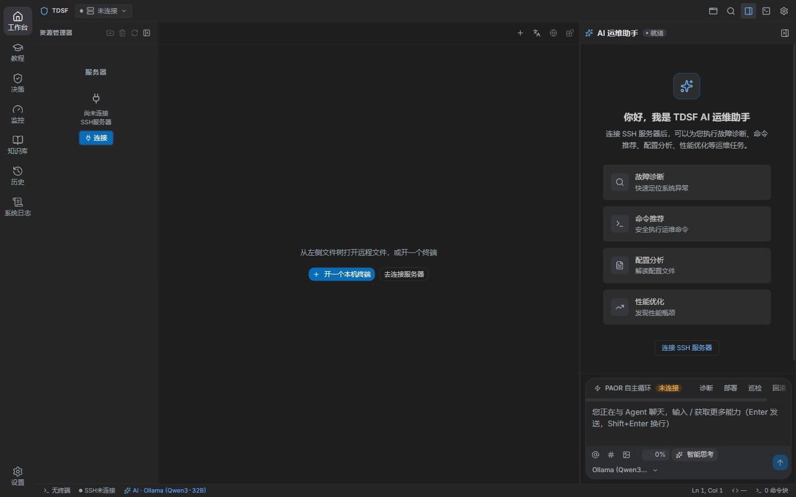
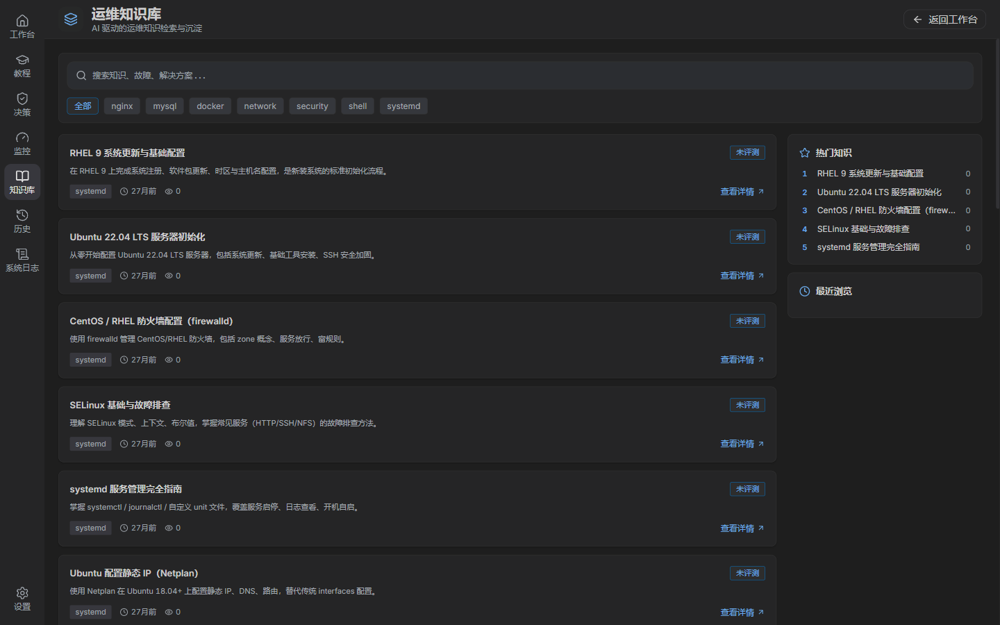
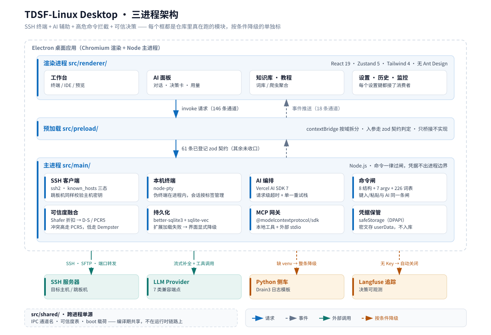

# TDSF-Linux Desktop

> 连上服务器敢敲下一条命令 —— SSH 终端 + AI 辅助 + 高危命令拦截 + 决策可信度透明化的桌面工具。

[](LICENSE)
[](https://www.electronjs.org/)
[](https://react.dev/)
[](https://www.typescriptlang.org/)
[](CONTRIBUTING.md)

在线预览：<https://harryopo.github.io/tdsf-linux-desktop/>

---

## 它解决什么

Linux 新手第一次连上服务器，最怕的不是看不懂报错，是**不知道这条命令敲下去会怎样**。
`rm -rf` 和 `df -h` 看起来一样长。

这个工具在三个地方拦一道：

1. **执行前**——命令先过风险闸，高危的直接挡下来，说清楚挡的是什么、会坏在哪、怎么回滚。
2. **执行时**——AI 在旁边解释，但它的每句话都带一个可信度分数和分数怎么来的。
3. **执行后**——所有决策进历史，能翻回去看当初为什么放行。

## 界面



*左：SSH 终端（命令-输出按块切分）；右：AI 面板，工具调用逐条成卡。*



*命令知识库：词条 + 事件沉淀 + 每条的综合置信度。*

暗色/浅色两套主题都是可用的（浅色由 `ui-audit` 逐元素量过对比度，不是"能看"）。

## 功能

### 命令风险闸

不是关键字黑名单那种一查就绕过的东西。判定分三层：

| 层 | 数量 | 例子 |
|---|---|---|
| 结构性拦截器 | 8 | fork 炸弹、`rm -rf /`、`dd` 写块设备、重定向覆写磁盘、根级 `chmod/chown` |
| argv 规则 | 7 | 按参数结构判，`find / -delete` 和 `find . -name x -delete` 不是一回事 |
| 命令规则词表项 | 226 | 受保护根级路径 15、只读命令 38（+48 扩展）、拒绝动词 62、前缀跳过 3 |

上表「数量」那一列的每个数都由 `npm run promo:check` 现场算并比对（分项由同一条命令打印），
所以正文里不再重复写数——2026-10-19 那次就是 README 与宣传页各抄一份、同时过期没人发现。

结构性拦截器**故意不放进数据文件**——它们靠正则和参数结构判断，写成可配数据只会让人误以为能把级别往下调。
判据的实测口径写在 [CODING.md](CODING.md) 与 `tests/unit/` 里那批命令闸用例。

### AI 辅助

- 多 Provider：类别数见下表「Provider 类型」（按 `provider-factory.ts` 的 switch 分支现数）——
  `anthropic` / `google` / `deepseek` / `qwen` / `volcengine-ark` / `ollama` / `openai-compatible`。
  智谱、Moonshot 这类走 `openai-compatible` 模板，不是独立分支。
- 流式：增量合并、思考链占位、迟到事件不丢、可中途停止（停止和失败分开报，不混成一个红条）。
- 上下文窗口按各家真实上限算，超了如实截断并标注，不假装塞得下。
- MCP 工具接入（`@modelcontextprotocol/sdk`），工具执行在前端逐条成卡。
- 所有网络请求界面可见——不给"静默把终端内容传走"留口子。

### 决策可信度

每个 AI 判断都拆成多源证据，在雷达图上画出各源权重与融合结果。融合源共 7 个，
以 `src/shared/credibility.ts` 的 `FUSION_SOURCE_IDS` 为准：日志、观测、知识库、AI 参数、人工、历史、最佳实践。
**分数低就明说分数低**，不包装成"仅供参考"。

各源先验先按 `decision.weights`（决策设置页可调）做一次 Shafer 折扣，再进 D-S 合成：
两两冲突低于 0.3 走 Dempster，高于就换 PCR5 重分配。实现在 `src/main/core/agent/credibility/`，
界面（`credibility:assess`）与 MCP 工具走的是同一条引擎，没有第二套简化算法。

### 终端与文件

- `ssh2` + `@xterm/xterm`；命令-输出块由 OSC 133/633 序列切分，切分逻辑是纯函数、可单测。
- 远端 shell 集成逐台确认后写入，随时可撤（撤完 rc 文件字节回到原样）。
- SFTP 文件树 + Monaco 编辑器，双击编辑、Ctrl+S 同步回远端。
- 本机终端走 node-pty，在主进程 require（`services/terminal/local-pty.ts`），不额外起子进程。

### 知识库

2236 条（`src/renderer/src/assets/dict/linux-commands-zh.json` 的 entries 计数）。
条目由三个来源合并而成（`jaywcjlove/linux-command` MIT、`tldr-pages` CC BY 4.0、人工标注），
**但条目里没有保留来源字段**，所以分项数只能按导入批次记账，加起来不等于 2236。
本机反馈会真的改变条目的成功率——不是只写不读的字段。

## 快速开始

```bash
git clone https://github.com/harryopo/tdsf-linux-desktop.git
cd tdsf-linux-desktop
pnpm install
pnpm dev
```

需要 Node.js 与 pnpm：CI 在 **Node 22** 上跑（`.github/workflows/ci.yml`），本机开发用的是 Node 24 + pnpm 11。
`package.json` **没有 `engines` 字段**，所以这些是"验证过的版本"，不是强制门槛。
模型 API Key 在 设置 → 模型配置 里填，不填也能跑（AI 走可见的失败态，不白屏）。

打包：`pnpm build:win` / `build:mac` / `build:linux`（electron-builder 26）。

## 质量与验证

页面里每个数字都带一条能复现它的命令——不写"约""等"，也不写没有出处的统计。
下表测量时间 **2026-10-19**（单元 15:49、端到端 20:04，UTC+8）。

| 读数 | 值 | 怎么量的 |
|---|---|---|
| 单元与组件用例 | 3276 通过 / 19 跳过 | `npm test`（271 个测试文件：269 通过 / 2 按环境跳过） |
| 端到端用例 | 57 通过 / 15 跳过 | `npx playwright test`（直驱真实应用窗口） |
| IPC 通道 | 272 | `npm run audit:ipc`（232 请求-响应 + 40 事件推送） |
| 已登记契约的通道 | 35 | `src/shared/ipc-contract.ts`（30 invoke + 5 event） |
| TypeScript / TSX 源文件 | 508 | `git ls-files src` 里 `.ts/.tsx` 计数 |
| Provider 类型 | 7 | `provider-factory.ts` 的 switch 分支数，`npm run promo:check` 现场算 |
| 命令规则词表项 | 226 | `npm run promo:check` 现场算 |

门禁链（每一道都是能跑红的闸，不是提醒）：

```
lint · typecheck · tests 类型检查 · vitest · knip 死代码 ·
design:gate · ui-audit --gate · ipc:check · build · playwright
```

其中 `ui-audit --gate` 的真命令是 `node scripts/design/ui-audit.mjs --gate`（它不是 npm script）。
另有几把闸只在本地跑、CI 里没有对应 job：`security:secrets` / `security:topology` / `security:history` /
`promo:check`——这条口径写进 [CLAUDE.md](CLAUDE.md) 的门禁清单，别把"有这道闸"当成"CI 会拦"。

安全侧常驻闸：`secret-gate`（凭据形状，扫跟踪集与暂存区）、
`topology-gate`（内网拓扑值，按值 + 按 /24 网段）、`history-env-scan`（全历史按值回归，pre-push 跑）、
`doc-links`（文档断链）。每条都配了阳性对照——报 0 命中之前先证明这把尺子扫得到东西。

## 架构



图由 `scripts/docs/arch-diagram.py` 生成（`python scripts/docs/arch-diagram.py` 重出，别手改 SVG）。
图上那几个数与仓库实测由 `promo-readout` 对账，漂了单测就红。

```
主进程  src/main/       Node.js：ssh2 / LLM / SQLite / 风险闸 / 可信度 / MCP / 技能
预加载  src/preload/    contextBridge 按域拆分，入参走 zod 契约判定
渲染层  src/renderer/   React 19 + Zustand 5 + lucide，沙箱隔离
共享    src/shared/     跨进程类型与常量的单源（IPC 通道名、可信度表、boot 载荷）
```

Electron 安全三原则全部为硬约束：`contextIsolation: true` / `nodeIntegration: false` / `sandbox: true`，
由 `design-contract` 与启动期断言钉住，不是靠自觉。

凭据不进任何文本通道：SSH 口令与 API Key 走 `safeStorage`（Windows DPAPI）加密落盘，
存在系统用户目录而不是仓库里；发往 LLM 的上下文按递归规则逐层打码。

## 已知边界（说清楚，不含糊）

这些是**当前状态**，不是待办清单的修辞：

- **可信度融合跑的是完整 D-S / PCR5，但各源先验是人工定标的**：折扣权重在决策设置里可调，
  先验本身（每条证据给多高分）来自规则与经验值，不是从数据里学出来的。融合算法不会替先验兜底。
- **14 步 Task Protocol 有代码、有测试，但生产链路零调用**。它是早期交付的产物，删或接都还没定。
  （原条目还写着"与 LangGraph 编排"——仓库里没有 LangGraph 依赖或代码，那句是抄来的，2026-10-19 删。）
  还有哪些能力属于这种半态，逐条列在 [docs/功能实景清单.md §C 组](docs/功能实景清单.md)。
- **Python 侧车（Drain3 日志模板挖掘）需要本机 venv**，缺依赖时整条日志聚类走降级，界面会显示降级原因。
  另注：`drain3-bridge.ts:235` 自陈模板抽取一直是内置正则——所以这条链路的"日志聚类"从来不是真 Drain3。
- **Langfuse 追踪没有 Key 时自动关闭**，不会静默上报。
- **安装包不随仓库发布**；`pnpm build:win` 只在本机验证过 Windows。
- 端到端有 15 条按环境跳过（2026-10-19 实测）：需要真 Linux 靶机、真模型 Key 或第二台机器的用例。

## 贡献

先看 [CONTRIBUTING.md](CONTRIBUTING.md) 与 [CODING.md](CODING.md)。
改 `src/renderer/**` 之前必读 [DESIGN.md](DESIGN.md)（界面规范唯一权威）。
想知道"现在真有什么、什么还没接上"，看 [docs/功能实景清单.md](docs/功能实景清单.md)；
想知道"接下来往哪走、每条凭什么"，看 [docs/长期优化目标.md](docs/长期优化目标.md)。

发现安全问题请走 [SECURITY.md](SECURITY.md) 私密披露，不要在 Issue 里公开。

## 许可证

[MIT](LICENSE) · 第三方依赖致谢见 [NOTICE](NOTICE)

---

## English

TDSF-Linux Desktop is an Electron desktop tool that makes the first SSH session survivable:
a three-layer command risk gate (8 structural detectors, 7 argv rules, 226 vocabulary entries),
AI assistance whose every answer carries an explicit credibility score with the evidence behind it,
and a full audit trail of what was allowed and why.

Electron 43 · React 19 · Zustand 5 · ssh2 · xterm.js · Monaco · Vercel AI SDK · MCP · better-sqlite3 ·
D-S evidence theory + PCR5 fusion · Vitest + Playwright.

3276 unit/component tests and 57 end-to-end tests driving the real app window
(19 and 15 respectively are environment-skipped; measured 2026-10-19).
See [Quick start](#快速开始), the [known boundaries](#已知边界说清楚不含糊)
and [docs/功能实景清单.md](docs/功能实景清单.md) for what is actually wired up.

MIT licensed.
